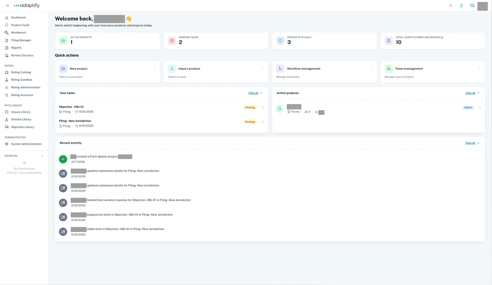
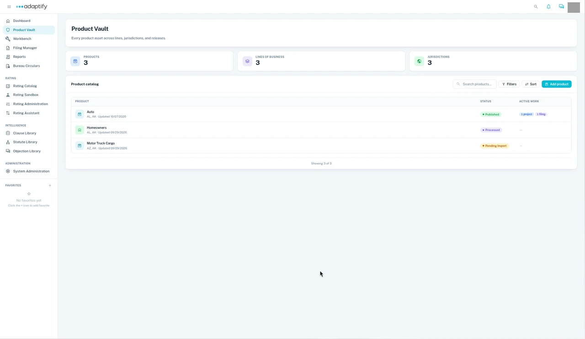
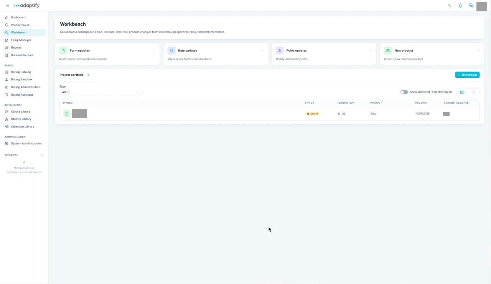
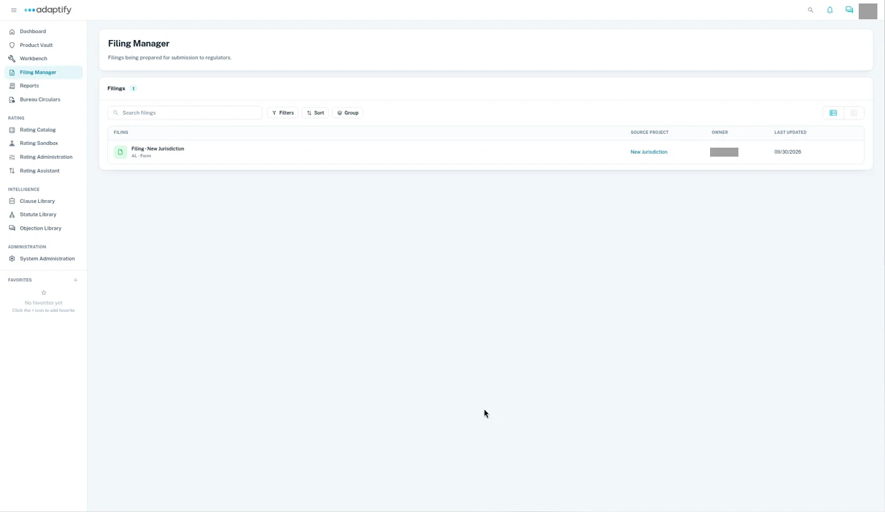

# Get Started

Adaptify Insurance Product Lifecycle Management (IPLM) is the operating system for P&C carriers.

Centralize forms, rules, rates, workflows and governance in one easy-to-use platform.

The Dashboard is where you start. The left navigation lists every area, with **Product Vault**, **Workbench** and **Filing Manager** at the top. Across the top of the page, the summary cards count your active projects, pending tasks, products in the Vault and total assets. **Quick actions** sits below them. **Your tasks** and **Active projects** show what needs you next, and **Recent activity** shows the latest changes across your projects.

Use the left navigation to move between the areas below at any time. It also lists other areas, such as **Reports** and **Bureau Circulars**.

## Dashboard

The Dashboard is the first page you see. It gives you a quick view of your projects, pending tasks and products.

- The summary cards show **Active projects**, **Pending tasks**, **Products in Vault** and **Total assets (forms and manuals)**.
- **Quick actions** start common work: **New project**, **Import product**, **Workflow management** and **Team management**.
- **Your tasks** lists your tasks, each with its type, time and status. **Active projects** lists the work underway.
- **Recent activity**, below them, shows what's happened recently across your projects, such as a note added or a project moved to End. Choose **View all** to see more.

See [Your Dashboard](dashboard.md).

## Product Vault

Product Vault is a governed repository for all products. It's the single source of truth for your product assets.

Product Vault opens with three summary cards for your products, lines of business and jurisdictions. Below them, the **Product catalog** lists each product with the states it covers and when it was last updated, its **Status** (such as **Published**, **Processed** or **Pending import**) and its **Active work**. **Search products**, **Filters**, **Sort** and **Add product** sit at the top right of the catalog.

- The summary cards count your **Products**, **Lines of business** and **Jurisdictions**.
- The **Product catalog** lists each product with its **Status** and **Active work**. Use **Search products**, **Filters** and **Sort** to find one, then open it to see its states and releases.
- Choose **Add product** to add a product to the Vault.

See [Product Vault overview](../product-vault/index.md).

## Project Workbench

Project Workbench is a collaborative environment for building new products and updating existing products.

Project Workbench opens with four cards for the kinds of work: **Form updates**, **Rate updates**, **Rules updates** and **New product**. Below them, the **Project portfolio** lists each project with its **Status**, **Jurisdiction**, **Product**, **Due date** and **Current assignee**. Use **Type** to filter the list, and choose **+ New project** to start one.

- The cards at the top cover the kinds of work: **Form updates**, **Rate updates**, **Rules updates** and **New product**.
- Your projects are listed in the **Project portfolio**. Use **Type** to filter them, or turn on **Show Archived Projects Only**.
- To start a project, choose **+ New project** at the top right of the **Project portfolio**. Then choose **Product update** to update forms, rates or rules, or **New product**.
- For a product update, pick **Forms**, **Rates** or **Rules** under **Project type**. Pick more than one to create a combined project with a child project for each type.

See [Workbench overview](../workbench/index.md).

## Filing Manager

Filing Manager lets you manage filings and objection handling all the way to approvals.

Filing Manager lists your filings under **Filings**. Each row shows the filing, its state and type, the **Source project** it came from, its **Owner** and when it was **Last updated**. Use **Search filings**, **Filters**, **Sort** and **Group** above the list to find one, then open it.

- **Filings** shows each filing as a card with its state and status.
- Once you have filings, use **Search filings**, **Filters**, **Sort** and **Group** to find one, then open it.

See [Filing Manager overview](../filing-manager/index.md).

## Next

Follow one product through its lifecycle in [Adaptify at a glance](components.md).
