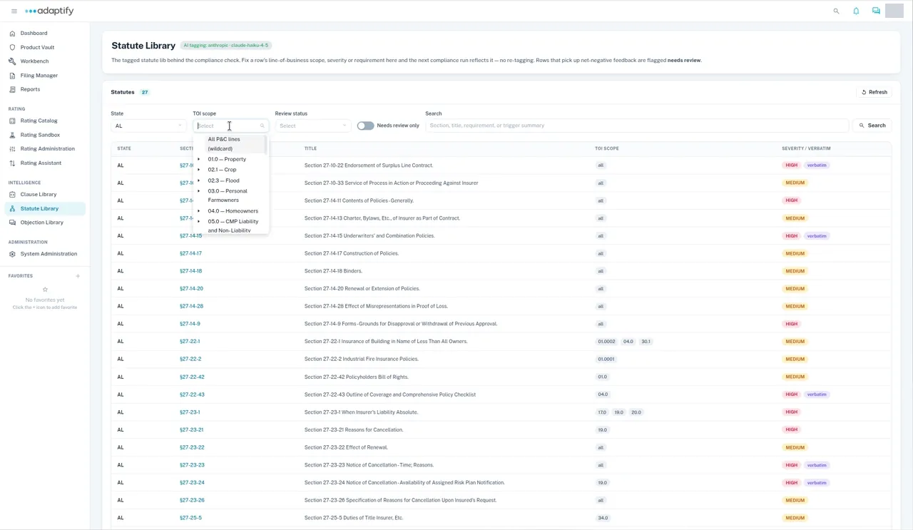

# Statute Library

The **Statute Library** holds the tagged statutes behind the compliance check. Each row shows a statute's state, section, title, type of insurance scope and severity.

## Find a statute

1. In the left navigation, under **Intelligence**, open **Statute Library**. The **Statutes** count shows how many are in the library.
2. Choose a **State**.
3. Narrow the list with **TOI scope** (type of insurance) or **Review status** (**draft** or **reviewed**). **TOI scope** fills in once you choose a state. It's a searchable tree of types of insurance, starting with **All P&C lines (wildcard)**, then codes such as 01.0 — Property and 04.0 — Homeowners.
4. To find a specific statute, type in the search box (section, title, requirement or trigger summary), then select **Search**.

To see only the statutes flagged for a second look, turn on **Needs review only**. Rows that get mostly negative feedback are flagged **needs review**. Select **Refresh** to reload the list.

## What each column shows

| Column | Shows |
|---|---|
| **State** | The state the statute belongs to |
| **Section** | The statute's section, as a link |
| **Title** | The statute's title |
| **TOI scope** | The types of insurance it applies to |
| **Severity / Verbatim** | How serious it is, for example **HIGH** or **MEDIUM**. Some rows also have a **verbatim** tag. |

## Fix a statute's tagging

You can correct a row's line-of-business scope, severity or requirement. The next compliance run uses your change, with no re-tagging.

Statutes can't be added or imported here.
