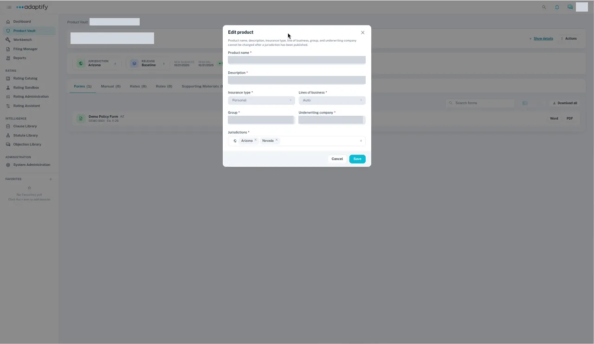
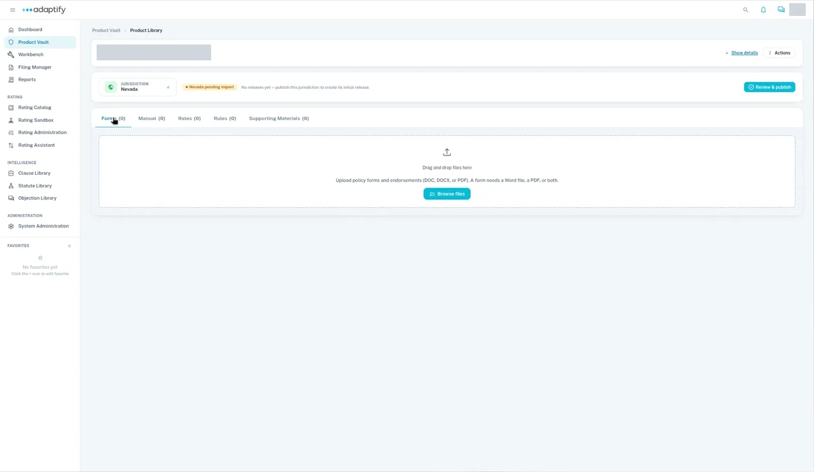

# Add a state with Edit product

Use this when you already sell the product in the state, but the state was never added in Adaptify. If you're expanding into a new state where you don't have the product yet, [start a project to add a state](../../workbench/create-project/new-jurisdiction.md) instead.

## Steps

1. Open **Product Vault** and open the product.
2. Select **Actions**, then **Edit product**.
3. Under **Jurisdictions**, add the new state. The rest of the product's details are locked once a state is published.
4. Select **Save**. You see "Product updated".
5. Choose the new state under **Jurisdiction**. It's empty and marked **pending import**, with "No releases yet — publish this jurisdiction to create its initial release."
6. Upload the state's documents on its page, or use **Actions** → **Import forms**, **Import manuals**, **Import rates** or **Import supporting materials**. See [Upload documents for a state](../import-documents.md).

The new state starts empty: no forms are copied from your other states. To start from another state's forms, [start a project to add a state](../../workbench/create-project/new-jurisdiction.md).

!!! note
    You can't add a state from the **Jurisdiction** selector on the product page. It only lists the product's current states.

## What happens next

Process and publish the new state like your first ones. See [Add metadata and process documents](../process-documents/index.md) and [Review and publish](../review-and-publish.md).

To compare both ways, see [Add a state to a product](index.md).
