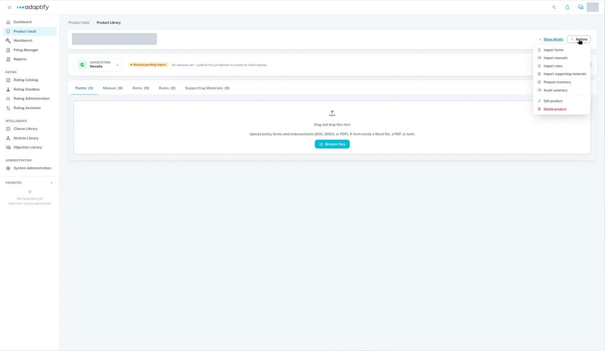
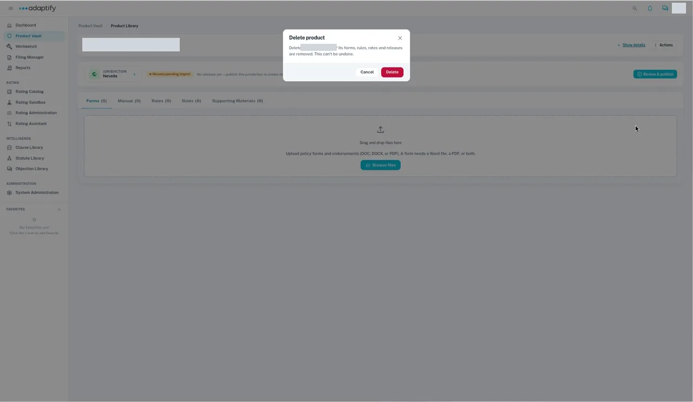
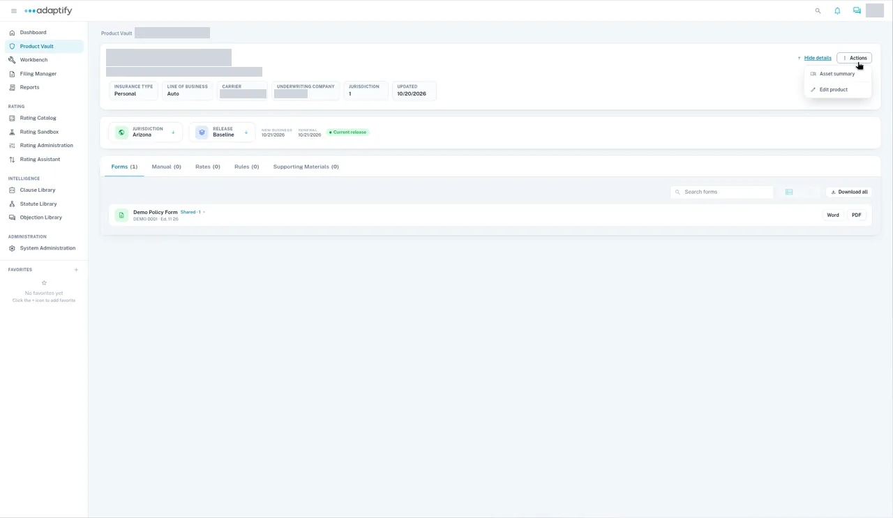

# Delete Product

Use this to fix a mistake, for example a product you created twice or with the wrong details. It isn't meant for routine cleanup. Right now, every user can delete a product.

You can delete a product only while none of its states is published. Once a state is published, **Delete product** no longer appears.

## Steps

1. Open **Product Vault** and open the product. Its states show **pending import**.
2. Select **Actions**, then **Delete product**.
3. The **Delete product** dialog says the product's forms, rules, rates and releases will be removed. Select **Delete**.
4. You see a message that the product was deleted, and you're back in the Product Vault.

!!! warning "This can't be undone"
    Deleting a product removes its forms, rules, rates and releases.

## If a state is published

When a product has a published state, its **Actions** menu shows only **Asset summary** and **Edit product**. There's no way to delete it in the app. `TODO verify` what to do if you need a published product removed.

To remove one state instead of the whole product, see [Delete a State](delete-a-state.md).
