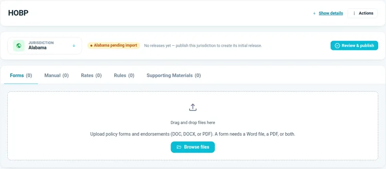

# Upload documents for a state

You upload files **one state at a time**.



## Prepare your files

A simple folder for each state keeps uploads quick:

```text
{Product}/{State}/Forms/                  DOC, DOCX or PDF
{Product}/{State}/Manuals/                PDF, DOC, DOCX, XLS or XLSX
{Product}/{State}/Supporting Documents/   for the Supporting Materials tab
```

## Steps

1. Open your product in the Vault and choose the state under **Jurisdiction**.
2. On the **Forms** tab, select **Browse files**, or drag and drop your files. A form needs a Word file, a PDF, or both.
3. On the **Manual** tab, upload the state's manuals. Rate manuals in Excel go here too.
4. On the **Supporting Materials** tab, upload your supporting documents.
5. Let each upload finish before you start the next one. Uploading one file at a time is the most reliable.
6. Check that each tab's count matches your files.

The state shows **Pending import** until you process it.

!!! tip "If a count still shows 0"
    Refresh the page before you upload again. The count can lag behind the upload, and uploading the same form twice gives a "Duplicate form" error.

!!! tip "Use a file name of its own for each form"
    Give each form a file name that no other product uses. A repeated file name can block publishing later. This is a known issue.

Next: [Add metadata and process documents](process-documents/index.md).
