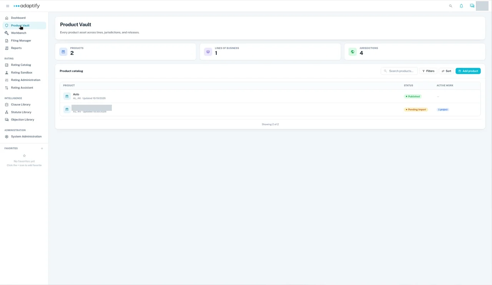

# Product Vault overview

**Governed repository for all products.**

The **Product Vault** (the Vault) is home base for every product you sell. Each state has its own tabs for forms, manuals, rates, rules and supporting materials. Process your documents, and Adaptify pulls rules from your manuals. Publish a state, and it gets its first release, the **Baseline**.

## At the top of the Vault

The summary cards show how many **Products**, **Lines of business** and **Jurisdictions** are in the Vault.

## Find a product

Your products are listed in the **Product catalog**, with each product's **Status** and **Active work**.

1. Select **Product Vault** in the left navigation.
2. Use **Search products...**, **Filters** or **Sort** to find the product.
3. Open the product.
4. Choose a state under **Jurisdiction**. A status chip next to it shows where that state stands, for example **Pending import** or **Processed**.

In the **Product catalog**, each row shows the product's states and when it was last updated. **Status** shows where the product stands, for example **Published** or **Pending Import**. **Active work** shows any open Workbench projects, for example **1 project**.

## What a product contains

Each state of a product has these tabs. The count on each tab shows how many items it holds.

| Tab | Holds |
|---|---|
| **Forms** | Policy forms and endorsements |
| **Manual** | Manuals, which the Vault reads to find your rules |
| **Rates** | Rate files |
| **Rules** | Rules extracted from your manuals |
| **Supporting Materials** | Supporting documents |

When you publish a state, its files become the product's **Baseline**: the first release that later updates build on. See [Review and publish](review-and-publish.md).

## See every asset on a product

To see all of a product's assets in one list, open the product and select **Actions**, then **Asset summary**. The **Assets summary** dialog has a tab each for **Forms**, **Manuals**, **Rules** and **Rates**. Each asset shows its status, for example **Published**, and the states it's used in. Draft assets that aren't used in any state can be deleted there.

## Bring a product in

New to the Vault? Follow [Bring a product into the Vault](bring-in-a-product.md). It takes you from a new product to a published state in four steps.

## What else you can do here

- [Add a state to a product](add-a-state/index.md) you already have in the Vault.
- [Understand releases](releases.md): Baseline, Current release, and how new releases arrive.
- [Shared assets across states](shared-assets.md): how one document is reused across states.
- Fix a mistake: [Delete a State](delete-a-state.md) or [Delete Product](delete-product.md).
