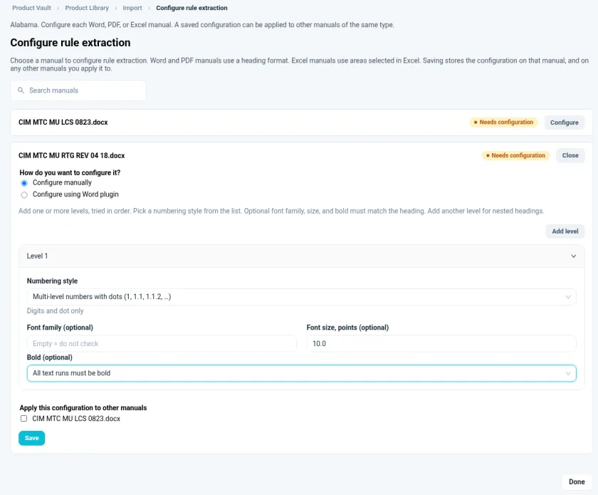
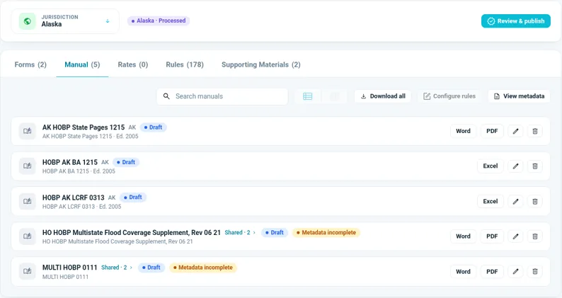

# Process and extract rules

## Configure rules

This tells the Vault how to find rules in your manuals.

1. Open the **Manual** tab and choose **Configure rules**.
2. On a manual marked **Needs configuration**, choose **Configure**.
3. Choose **Configure manually**. You can also choose **Configure using Word plugin**.
4. Pick the **Numbering style** that matches your manual's headings, for example multi-level numbers with dots (1, 1.1, 1.1.2).
5. Optionally, set the font family, size and bold.
6. Optionally, apply the same setup to your other Word manuals.
7. Choose **Save**, then **Done**.

For Excel manuals, select the rule areas in Excel. A manual marked **Shared · 2** is used by more than one state, so you configure it just once.

!!! tip "Configure first, then process"
    Set up rules before you process. Once a manual is processed, its configuration is locked in.

## Process documents

1. Choose **Process documents**.
2. If a manual isn't configured yet, you'll be asked about it. Choose **Continue**, or cancel and configure it first.
3. Wait for processing to finish. Uploads and edits pause while it runs.

When it's done, the status shows **{State} · Processed**, and the **Rules** tab lists your extracted rules. The sample Auto and Homeowners manuals produced about 150–180 rules each.

Repeat these steps for each state.

## Next: review and publish

Choose **Review & publish** to create the state's first release. `TODO verify`
