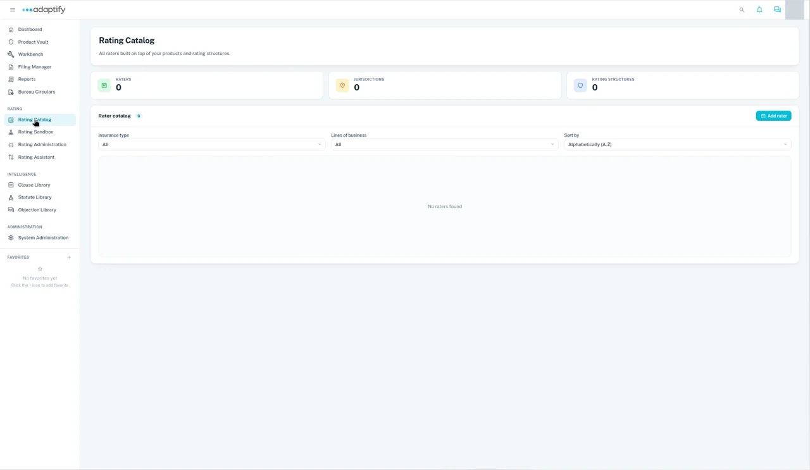
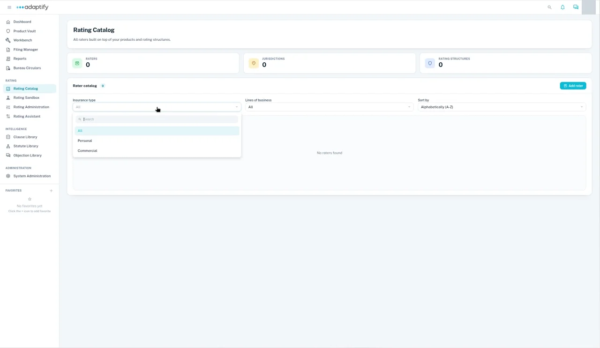
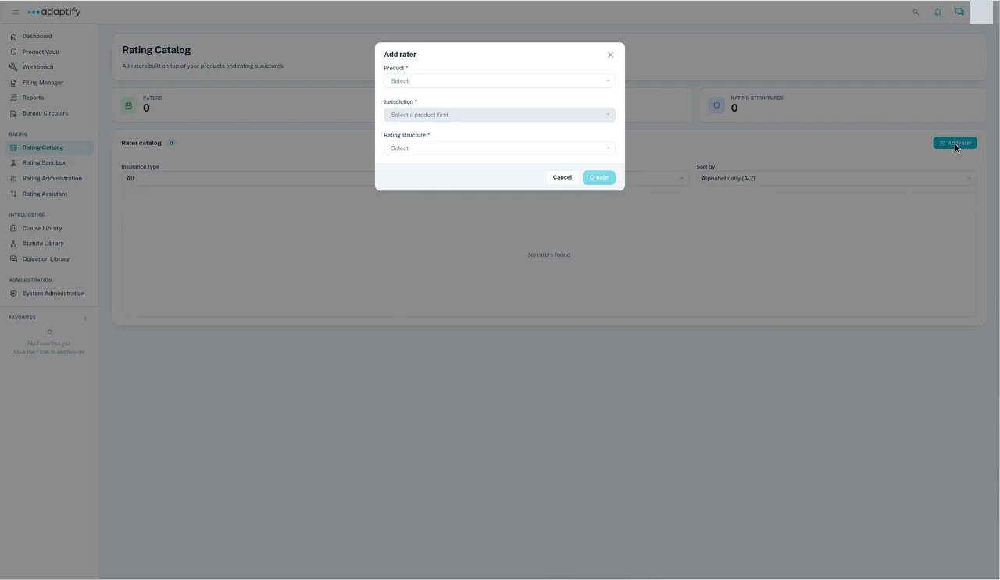

# Rating Catalog

The Rating Catalog is where approved products become operational. It lists all the raters built on your products and rating structures. Each rater ties a product and one of its jurisdictions to the rating structure it's built on.

Open it from **Rating Catalog** under **Rating** in the left navigation.

## What you'll see

- **Summary cards:** how many **Raters**, **Jurisdictions** and **Rating structures** you have.
- **Rater catalog:** the list of raters, with a count. **Add rater** is at its top right.

## Filter and sort the list

Above the list, use:

- **Insurance type:** **All**, **Personal** or **Commercial**.
- **Lines of business:** narrow the list to a line of business. Each filter has a search box.
- **Sort by:** **Alphabetically (A-Z)** or **Alphabetically (Z-A)**.

## Add a rater

A rater is built on a rating structure, so the rating structure you want must exist before you start.

1. In the **Rater catalog**, select **Add rater**.
2. Choose the **Product**. The list shows the products in your Product Vault.
3. Choose the **Jurisdiction**. It's available once you've picked a product.
4. Choose the **Rating structure** the rater is built on.
5. Select **Create**. It's available once all three fields are filled in.

To see how a product moves through Adaptify, see [Adaptify at a glance](../get-started/components.md).
