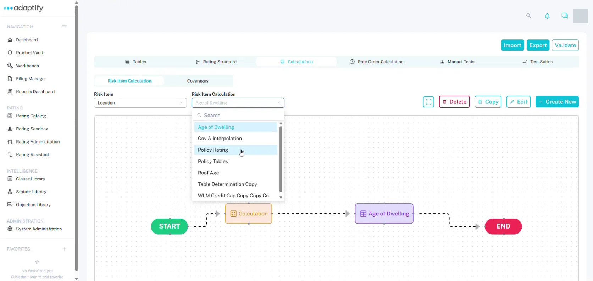

# Calculations

Calculations turn your table values and rating inputs into premium. Each calculation is a flow you build on a canvas, from **START** to **END**.

## Find a calculation flow

Open the rater and choose the **Calculations** tab. It has two views:

- **Risk item calculation:** choose the **Risk item**, such as **Policy**, then the **Risk item calculation**. To start a new one, select **+ Create new**. In **Create new risk item calculation**, enter the **Risk item calculation name**, choose the **Risk item**, then select **+ Create new risk item**.
- **Coverages:** choose the **Risk item**, such as **Vehicle**, then the **Coverage**, such as **Bodily Injury Liability**. Each coverage already has a flow that runs from **START** to **END**, ready for you to build on.

The flow that's open appears below the pickers, with **Delete**, **Copy** and **Edit**.

## Build the flow

1. Select **Edit**. The flow opens full screen, with the **Table**, **Calculation** and **Branch** nodes at the top left.
2. Drag the node you need onto the canvas:
    - **Table:** looks up a rating table.
    - **Calculation:** a set of math steps.
    - **Branch:** sends the flow one way or another, based on a condition.
3. Connect the nodes in order, from **START** to **END**. For example: START → your base rate table → a premium calculation → END.
4. Double-click a node to configure it. For a **Table** node, open **Configure table** and pick the table under **Available tables**. It then shows as the **Selected table**. A new Table node stays empty until you pick its table.
5. Select **Save changes**, or **Cancel** to discard your changes.

Once the flow is saved, each Calculation node shows how many steps it has, for example "Calculation · 1 step".

## Configure a calculation

Double-click a **Calculation** node to open **Configure calculation**.

1. Enter a **Name**, for example BI Premium.
2. Choose a function under **Add functions** to create a step. Each step can use the result of an earlier one.
3. Fill in each part of the step. Select a part, such as **Pick left** or **Pick right**, and choose what to **USE**:
    - **Step:** the result of an earlier step.
    - **Field:** a field from the rating structure, picked from **Select field**.
    - **Value:** a number you type in.
4. Select **Save**.

For example, BI Premium could set Policy.Vehicle.Bodily Injury Liability.Premium to the base rate from the table × 1.

If a part is still empty, you'll see "Values are missing for one or more functions". Fill it in before you save.

## Next

[Rate order](rate-order.md)
