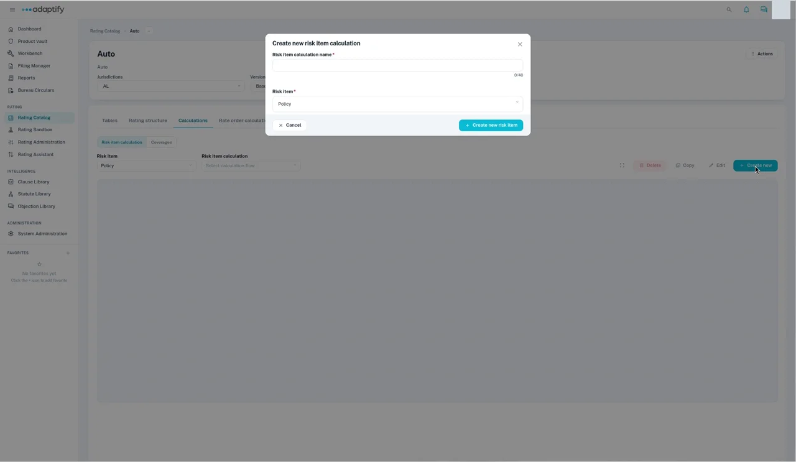
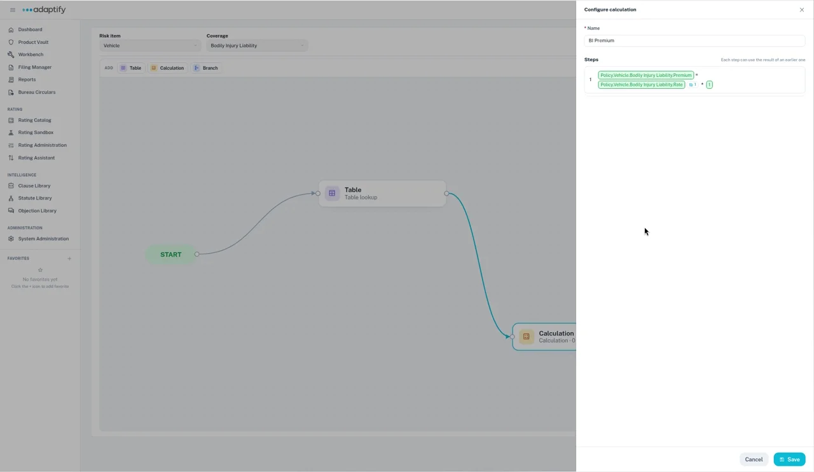

# Calculations

Calculations turn your table values and rating inputs into premium. Each calculation is a flow you draw on a canvas, step by step.

## Find or start a calculation

1. Open the rater and choose the **Calculations** tab. It has two views: **Risk item calculation** and **Coverages**.
2. Choose the **Risk item**, such as **Policy**, then the **Risk item calculation**. Its flow appears on the canvas.
3. To start a new one, select **+ Create new**. In **Create new risk item calculation**, enter the **Risk item calculation name**, choose the **Risk item**, then select **+ Create new risk item**.

You can also **Delete**, **Copy** or **Edit** the calculation that's open.

## What's on the canvas

Every flow runs from **START** to **END**. In between, you link these nodes with arrows:

- **Table:** looks up a rating table.
- **Calculation:** a set of math steps.
- **Branch:** a condition that sends the flow one way or another, such as checking for a wind exclusion. Each path can have a label.

Select **Edit** to change the flow. Add nodes from the palette on the left, then link them.

## Configure a calculation

Open a **Calculation** node to configure it.

1. Enter a **Name**.
2. Under **Add Functions**, choose a function. It's added to **Steps**. Functions include **+**, **-**, **\***, **/**, **ROUND**, **ROUND_UP**, **DAYS_BETWEEN**, **MONTHS_BETWEEN**, **YEARS_BETWEEN**, **YEAR**, **IF**, **FOR_EACH** and **TABLE_LOOKUP**.
3. Fill in each part of the step. For each one, choose a **Binding Type**:
    - **Step:** the result of an earlier step.
    - **Path:** a field from the rating structure, picked from **Select Path**.
    - **Value:** a number you type in.
4. Select **Save**.

For example, step 1 could be Fire Peril Base Rate × Fire Territory Factor, and a later step could round the result.

If a part is still empty, you'll see "Values are missing for one or more functions". Fill it in before you save.

## Configure a branch

Open a **Branch** node to set its condition in **Configure Condition**: give it a **Name**, build the **IF** condition, then add what happens under **THEN** and **ELSE**.

## Check your work

Open the rater's **Actions** menu and choose **Validate**.

## Next

[Rate order](rate-order.md)
