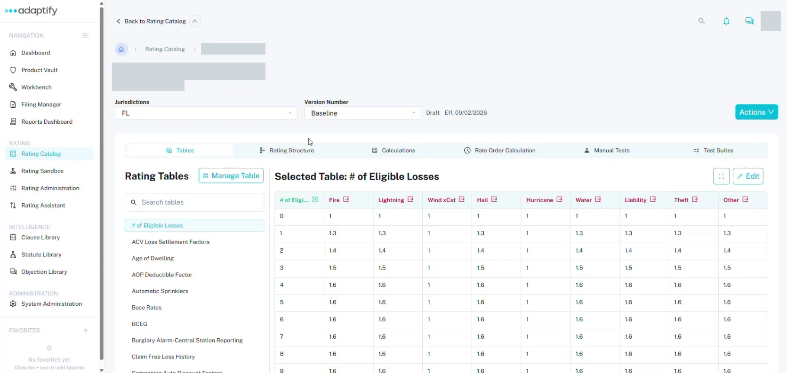

# Open a rater

Open a rater from the [Rating Catalog](../rating-catalog/index.md) to build and test it.

## What's on a rater

- **Back to Rating Catalog** returns you to the list. The breadcrumb shows **Rating Catalog** and the rater's name.
- **Jurisdictions:** the state you're working on, for example **FL**.
- **Version Number:** the version, for example **Baseline**, with its status (such as **Draft**) and effective date.
- **Actions:** at the top right.

## The six tabs

| Tab | Use it to | Guide |
|---|---|---|
| **Tables** | Build and fill in your rating tables. | [Rating tables](rating-tables.md) |
| **Rating Structure** | See the rater's rating structure. | [Rating structures](rating-structures.md) |
| **Calculations** | Draw the calculation flow for each risk item. | [Calculations](calculations.md) |
| **Rate Order Calculation** | Set the order the calculations run in. | [Rate order](rate-order.md) |
| **Manual Tests** | Create test cases one at a time and run them. | [Test a rater](test-a-rater.md) |
| **Test Suites** | Run many test cases from a file. | [Test a rater](test-a-rater.md#test-suites) |
