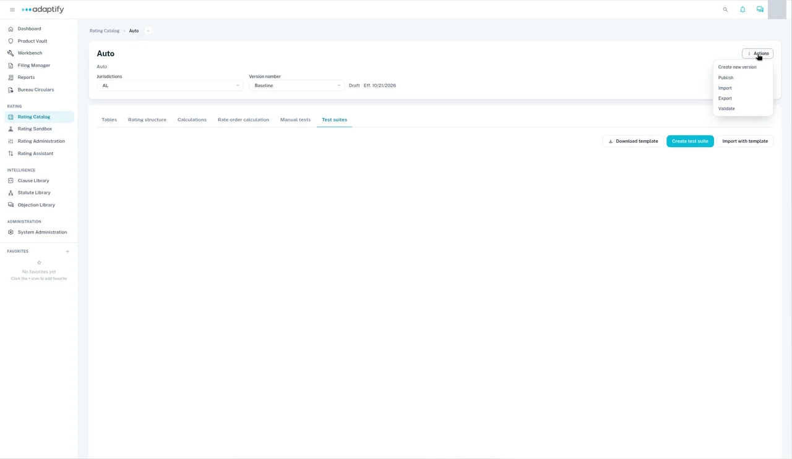

# Open a rater

In the [Rating Catalog](../rating-catalog/index.md), select the rater's row in the **Rater catalog** to open it.

## What's on a rater

- **Breadcrumb:** **Rating Catalog** and the product's name. The product name is also the rater's title.
- **Jurisdictions:** the state you're working on, for example **AL**.
- **Version number:** the version, for example **Baseline**, with its status (such as **Draft**) and effective date.
- **Actions:** **Create new version**, **Publish**, **Import**, **Export** and **Validate**.

## The six tabs

| Tab | Use it to | Guide |
|---|---|---|
| **Tables** | Build and fill in your rating tables. | [Rating tables](rating-tables.md) |
| **Rating structure** | See the structure the rater is built on, and pick an item to view its fields. | [Rating structures](rating-structures.md) |
| **Calculations** | Draw the calculation flow for each risk item or coverage. | [Calculations](calculations.md) |
| **Rate order calculation** | Set the order the calculations run in. | [Rate order](rate-order.md) |
| **Manual tests** | Create test cases one at a time and run them. | [Test a rater](test-a-rater.md) |
| **Test suites** | Run batches of tests from a spreadsheet. | [Test a rater](test-a-rater.md#test-suites) |
