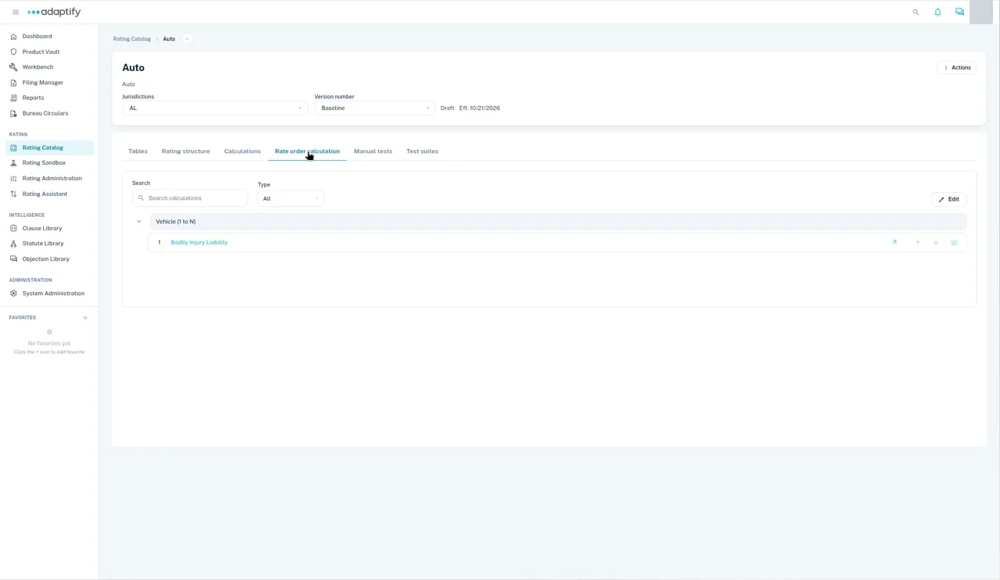

# Rate order

The rate order is the order Adaptify runs your calculations in. Open the rater and choose the **Rate Order Calculation** tab.

The calculations are numbered and grouped by risk item, such as **Protected Devices**, **Location** and **Policy**. Use **Search Calculations** and **Type** to find one. Select **Edit** to change the order.

## Get the order right

- Put the tables before the calculations that use them.
- Put **Total Premium** last.

When you're done, select **Validate** above the rater's tabs. **Import** and **Export** sit next to it.

## Next

[Test a rater](test-a-rater.md)
