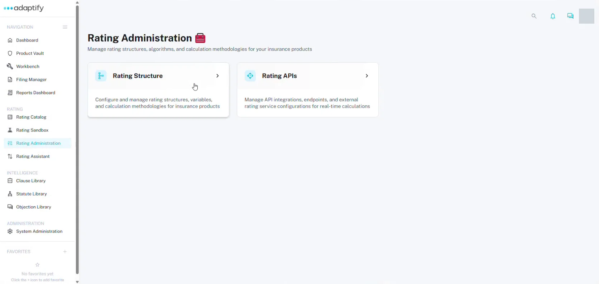
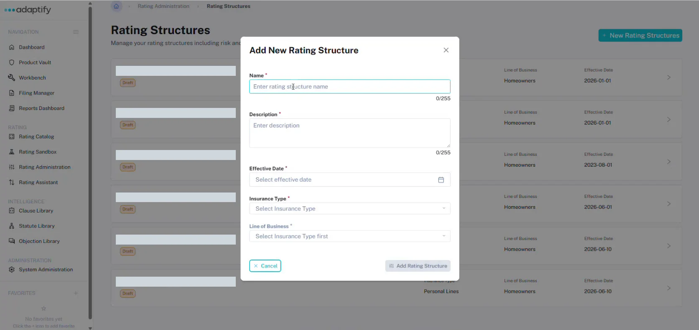
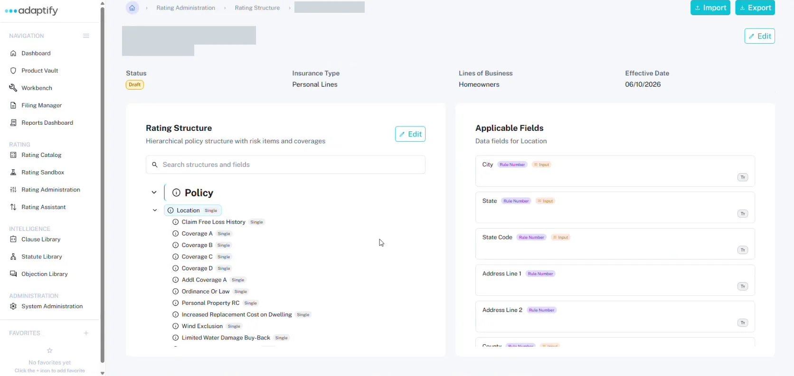

# Rating Administration and rating structures

A rating structure lists every risk item, coverage and field used to develop the rate. You set it up in **Rating Administration**, before you build tables and calculations.

## Open Rating Administration

Select **Rating Administration** under **Rating** in the left navigation. You'll see two cards:

- **Rating Structure:** configure and manage rating structures, variables and calculation methodologies.
- **Rating APIs:** manage API integrations, endpoints and external rating service configurations.

Choose **Rating Structure** to see your **Rating Structures** list. Each structure shows its status (for example **Draft**), **Insurance Type**, **Line of Business** and **Effective Date**.

## Create a rating structure

1. On **Rating Structures**, select **+ New Rating Structures**.
2. In **Add New Rating Structure**, enter the **Name** and **Description**, and pick the **Effective Date**.
3. Choose the **Insurance Type**, then the **Line of Business**.
4. Select **Add Rating Structure**. You'll see "Rating structure created successfully".

## What's on a structure

Open a structure to see:

- Its **Status**, **Insurance Type**, **Lines of Business** and **Effective Date**, with **Import**, **Export** and **Edit** at the top.
- **Rating Structure:** the tree of risk items and coverages, starting with **Policy**. Each item shows its cardinality, such as **Single**. Use **Search structures and fields** to find one.
- **Applicable Fields:** select an item in the tree to see its fields. Fields used as rating inputs show an **Input** tag, and rating outputs show an **Output** tag.

## Build the structure in Excel

Building the structure in Excel is faster than adding fields one by one.

1. On the structure, select **Export** to download it as an Excel file.
2. Fill it in. The file has a sheet for each part of the structure, such as **Policy**, **Location** and each coverage. Each sheet lists its fields in these columns:

    | Column | What to enter |
    |---|---|
    | **Field Name** | The field, for example Zip code or Protection Class. |
    | **Data Type** | **Number** (decimals are fine), **String** or **Boolean**. Dates use **Date**. |
    | **Sequence Number** | The order the field appears in on the test input screen. Leave gaps, such as 10, 20, 30, so you can slot new fields in later. |
    | **Rating Input** | **TRUE** if you need to enter this value to rate, for example Zip code or Protection Class. |
    | **Rating Output** | **TRUE** only if you want to see the value in the output, for example Territory. |

3. Back on the structure, select **Import** and choose your file. You'll see "Import Excel completed successfully".

### Cardinality: Single or Multi

Each risk item or coverage is **Single** or **Multi**. Use **Multi** for things a policy can have more than one of, such as several locations, scheduled personal property or coverages.

## Missing a field?

If you find a field is missing while you build a table, add it to your structure file and import it again here. Then go back to your table. You can't add fields from the table screen.

!!! tip
    Keep your structure file open while you build tables, and import again whenever you add a field.

## Next

[Open a rater](open-a-rater.md)
