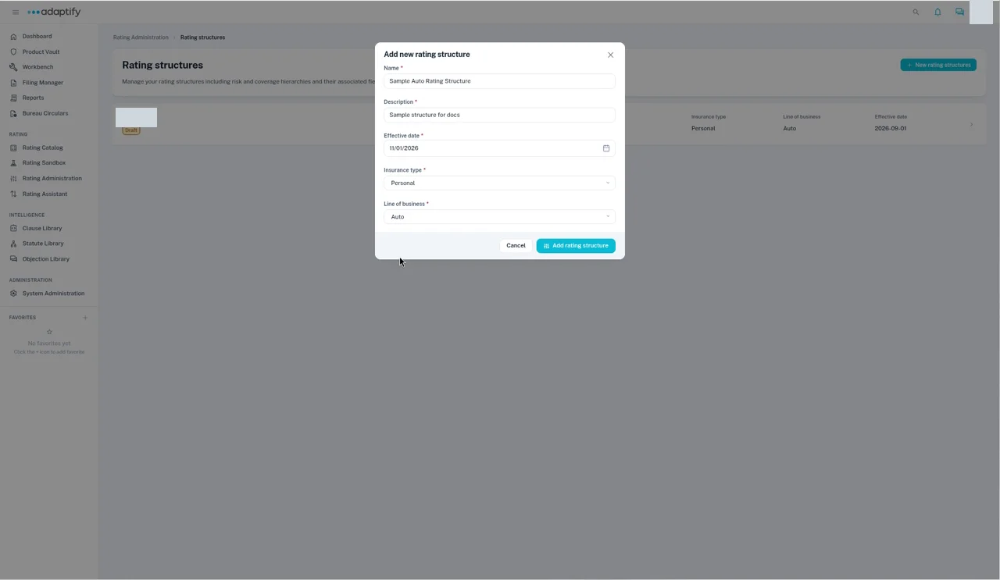
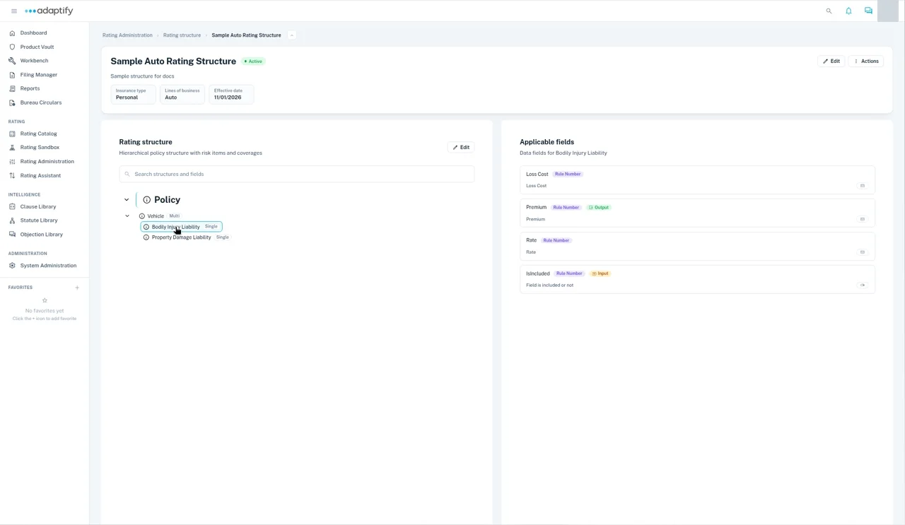
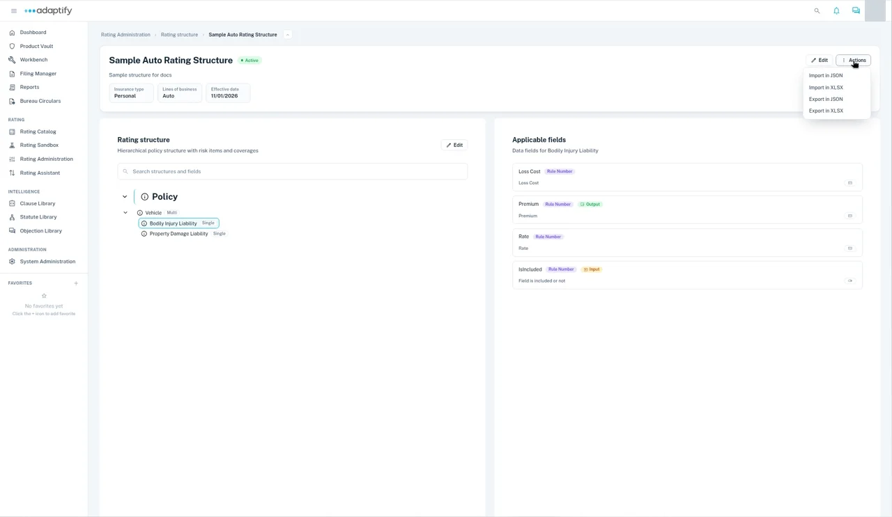

# Rating Administration and rating structures

A rating structure lists every risk item, coverage and field used to develop the rate. You set it up in **Rating Administration**, before you build tables and calculations.

## Open your rating structures

1. Select **Rating Administration** under **Rating** in the left navigation. You'll see two cards: **Rating structure** and **Rating APIs**.
2. Choose the **Rating structure** card. The **Rating structures** list opens.

Each structure in the list shows its name, a status badge (**Draft** or **Active**), **Insurance type**, **Line of business** and **Effective date**.

## Create a rating structure

1. On **Rating structures**, select **+ New rating structures**.
2. In **Add new rating structure**, enter the **Name** and **Description**, and pick the **Effective date**.
3. Choose the **Insurance type**, then the **Line of business**. All five fields are required.
4. Select **Add rating structure**. You'll see "Rating structure created successfully", and the new structure opens as **Draft** with a single **Policy** item.

## What's on a structure

- **Header:** the name, status badge, description, and the **Insurance type**, **Lines of business** and **Effective date**. **Edit** and **Actions** are at the top right.
- **Rating structure:** the tree of risk items and coverages, starting with **Policy**. Each item shows its cardinality, **Single** or **Multi**. Use **Search structures and fields** to find one.
- **Applicable fields:** select an item in the tree to see its fields. Fields used as rating inputs show an **Input** tag, and rating outputs show an **Output** tag.

## Add risk items and coverages

1. In the **Rating structure** panel, select **Edit**. The tree switches to edit mode and the button becomes **Exit edit**.
2. Select **Add** on the item you want to add under.
3. In **Add new item**, choose the **Type** (**Risk item** or **Coverage**), and enter the **Name** and **Description**.
4. Choose the **Cardinality** and an **Icon**, then select **Add**. You'll see "New item created successfully".
5. Select **Exit edit** when you're done.

Use **Multi** for things a policy can have more than one of, such as several locations or vehicles, scheduled personal property or coverages. Use **Single** for everything else.

## Build the structure in Excel

Building the structure in Excel is faster than adding fields one by one.

1. On the structure, open **Actions** and choose **Export in XLSX**.
2. Fill in the file. It has a sheet for each part of the structure, such as **Policy**, **Location** and each coverage. Each sheet lists its fields in these columns:

    | Column | What to enter |
    |---|---|
    | **Field Name** | The field, for example Zip code or Protection Class. |
    | **Data Type** | **Number** (decimals are fine), **String** or **Boolean**. Dates use **Date**. |
    | **Sequence Number** | The order the field appears in on the test input screen. Leave gaps, such as 10, 20, 30, so you can slot new fields in later. |
    | **Rating Input** | **TRUE** if you need to enter this value to rate, for example Zip code or Protection Class. |
    | **Rating Output** | **TRUE** only if you want to see the value in the output, for example Territory. |

3. Back on the structure, open **Actions** and choose **Import in XLSX**, then pick your file.

**Actions** also has **Import in JSON** and **Export in JSON**.

## Change the structure's details or status

Select the header **Edit** to change the **Title**, **Description**, **Status** (**Active** or **Draft**), **Insurance type**, **Lines of business** or **Effective date**. Then select **Save changes**.

## Missing a field?

If you find a field is missing while you build a table, add it to your structure file and import it again here. Then go back to your table. You can't add fields from the table screen.

!!! tip
    Keep your structure file open while you build tables, and import again whenever you add a field.

## Next

[Open a rater](open-a-rater.md)
