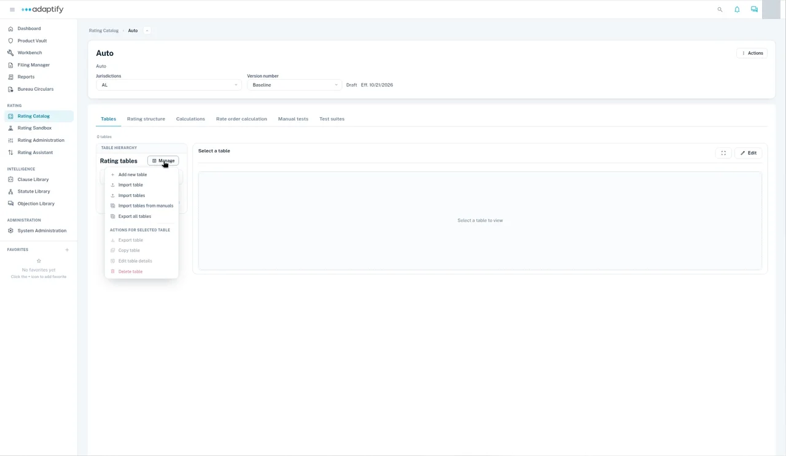
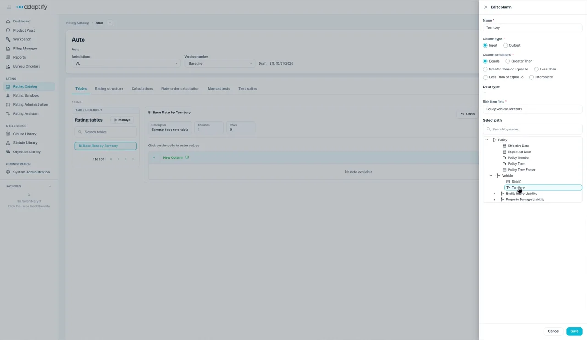
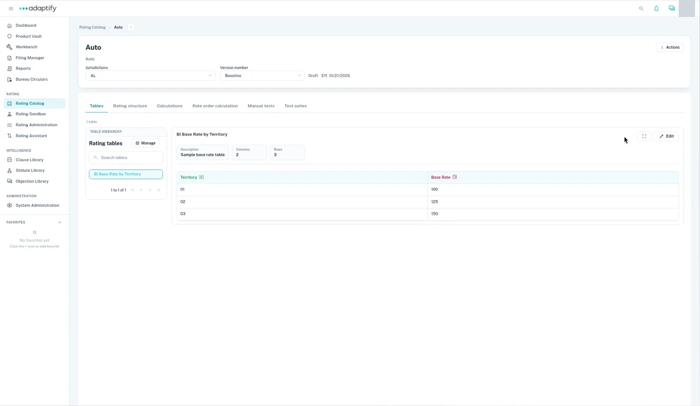

# Rating tables

Rating tables hold your rates and factors, such as base rates, territory factors or age of home factors. Each column is linked to a field in the rating structure, so Adaptify knows what to look up and where to put the result.

Open the rater and choose the **Tables** tab. The **Rating tables** panel lists the tables. Use **Search tables** to find one, then select it to view it. Input and output columns are marked with different icons.

## The Manage menu

Select **Manage** next to **Rating tables** to:

- **Add new table**, **Import table**, **Import tables**, **Import tables from manuals** or **Export all tables**.
- Under **Actions for selected table**: **Export table**, **Copy table**, **Edit table details** or **Delete table**. Select a table first.

## Add a table

1. Select **Manage** → **Add new table**.
2. Enter the **Name** and, if you like, a **Description**.
3. Choose the **Type**: **None or unspecified**, **Premiums**, **Loss costs**, **Factors** or **Relativities**.
4. Enter the **Rule number**, if there is one.
5. Select **Add table**. The new, empty table opens.

## Set up the columns

1. Select the table, then select **Edit**.
2. Select **New Column**. The **Edit column** panel opens.
3. Enter the column's **Name**.
4. Choose the **Column type**: **Input** for a value you look up by, such as Zip code, or **Output** for the value you get back, such as Territory.
5. For an input column, choose the **Column conditions**: **Equals**, **Greater Than**, **Greater Than or Equal To**, **Less Than**, **Less Than or Equal To** or **Interpolate**.
6. Under **Select path**, search for and pick the structure field this column maps to. It fills in the **Risk item field**, for example Policy.Vehicle.Territory for an input or Policy.Vehicle.Bodily Injury Liability.Rate for an output, and shows its **Data type**.
7. Select **Save**. Add the next column the same way.
8. Select **Save changes** to save the table, or **Cancel** to discard your changes. **Undo** and **Redo** step through your edits.

## Fill in the table

While you edit the table, select a cell to type a value into it, then select **Save changes**. For a large table, it's quicker to use a file:

1. Select **Manage** → **Export table**. You get a CSV file with the column headers.
2. Fill in the rows in Excel and save it as CSV.
3. Select **Manage** → **Import table**, then choose your CSV file.

The saved table shows its **Description**, **Columns** and **Rows**, with input and output columns marked by different icons.

## Add the table to a calculation

Add each new table to your [Calculations](calculations.md). That's what brings it into the rate order and your tests.
