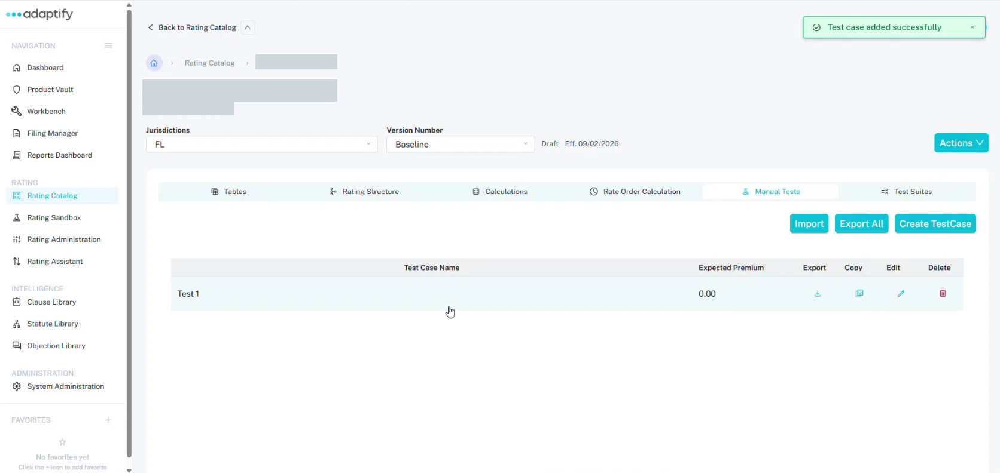

# Test a rater

Test a rater by entering rating inputs and comparing the premium Adaptify works out with the premium you expect.

## Create a test case

1. Open the rater and choose the **Manual Tests** tab.
2. Select **Create TestCase**.
3. In **Add New Manual Test**, enter the **Test Case Name** and the **Expected Premium**, then select **+ Add Test**. You'll see "Test case added successfully".

The list shows each test's **Test Case Name** and **Expected Premium**, with **Export**, **Copy**, **Edit** and **Delete**. You can also **Import** test cases, or **Export All**.

## Run a test

1. Open the test case. You'll see the **Expected Premium** and **Actual Premium**.
2. On **Rating Inputs**, fill in the inputs. These are the fields marked as rating inputs in the structure, in sequence-number order. Use the **Policy** tree on the left to move between risk items.
3. Select **Execute Test**. A message tells you whether the test passed, with the premium.

If a required input is missing, the test fails. Fill it in and run the test again.

## Read the Rate Log

Choose **Rate Log** to follow the math step by step. It's the quickest way to find out why a premium is off.

- The list on the left shows each calculation in rate order, grouped by risk item.
- For each table lookup, you see the **Input** and **Output**: the field, its path and its value.
- For each calculation, you see each step with the numbers filled in and its result.
- For each branch, you see the **IF**, **THEN** and **ELSE**, with the path that was taken.

Use the filters at the top, such as **Risk Item**, **Coverage** and **Node Type**, to narrow the log.

## Test suites

To run many test cases at once, use the **Test Suites** tab. It has **Download Template**, **Create Test Suite** and **Import with Template**. Each suite shows its **Name**, how many tests **Passed** and **Failed**, the **File**, **Last Run** and **Status**.
