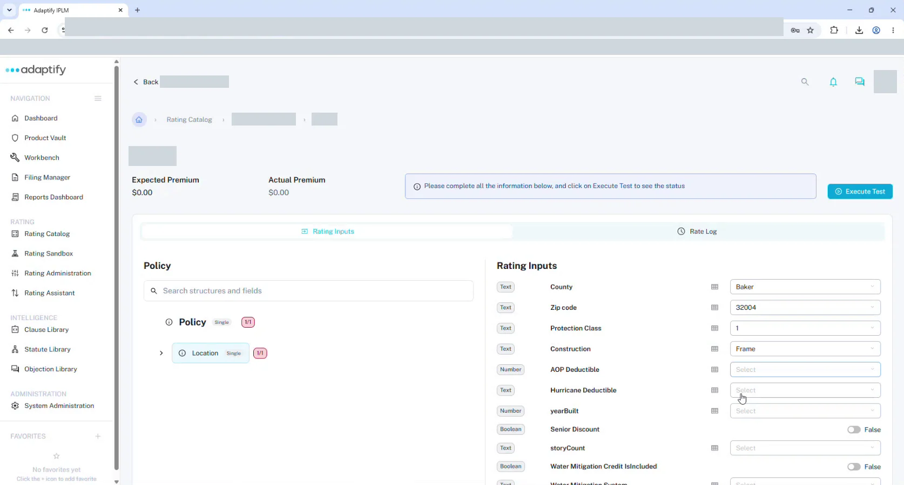
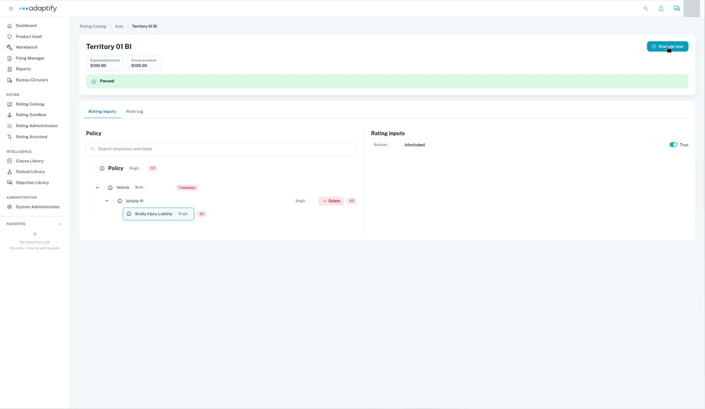
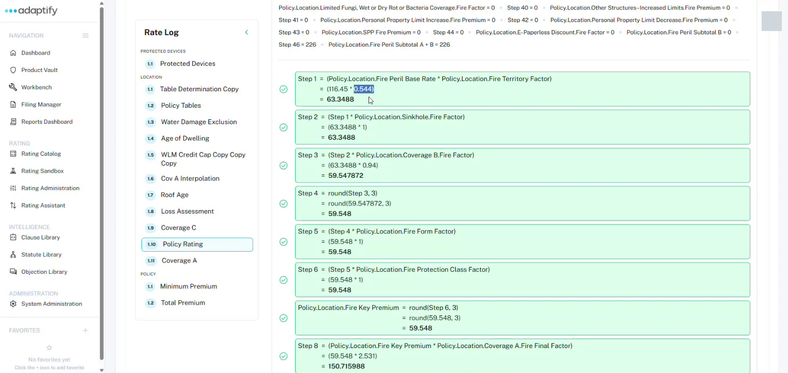

# Test a rater

Test a rater by entering rating inputs and comparing the premium Adaptify works out with the premium you expect.

## Create a test case

1. Open the rater and choose the **Manual tests** tab.
2. Select **Create test case**.
3. In **Add new manual test**, enter the **Test case name** and the **Expected premium**, then select **Add test**.

You can also **Import** test cases from a JSON file exported from manual tests, or **Export all**.

## Run a test

1. Open the test case. The header shows the **Expected premium** and **Actual premium**, with **Execute test** at the top right.
2. On **Rating inputs**, use the **Policy** tree to move between risk items and coverages. For a **Multi** item, such as **Vehicle**, add an instance, such as **Vehicle #1**. Use **Delete** to remove one.
3. Select an item to see its inputs on the right, under **Rating inputs**, and fill them in. These are the fields marked as rating inputs in the structure. Some inputs offer a list of values, such as the territories in your table.
4. Give every required input a value, then run the test: select **Execute test**.

The banner shows the result, such as **Passed**, and **Actual premium** shows the premium Adaptify worked out.

## Read the Rate log

Choose **Rate log** to follow the math step by step. It shows exactly how each premium was worked out.

- The **Rate log** list on the left shows each calculation, grouped by risk item.
- For each table lookup, you see the **Input** and **Output**: the field, its path and its value.
- For each calculation, you see the **Variable values**, then each step with the numbers filled in and its result.

Use **Search** and the **Risk item**, **Risk item calculation**, **Coverage** and **Node type** filters to narrow the log. Select **Export PDF** to save it.

## Test suites

To run a batch of tests from a spreadsheet, use the **Test suites** tab:

1. Select **Download template** and fill it in.
2. Select **Create test suite**, enter the **Test suite name**, choose your file (XLSX, XLS or CSV), and select **Create**. You can also use **Import with template**.

Each suite shows how many of its tests passed and failed, its file, when it last ran and its status.
