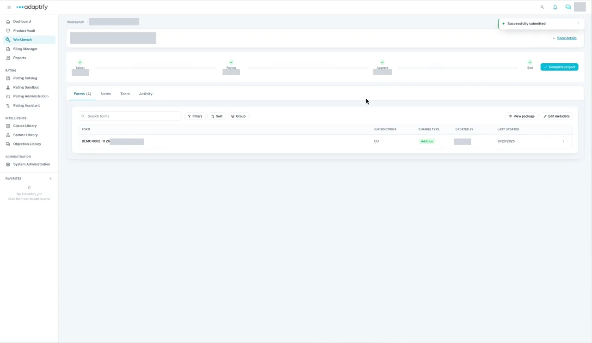

# Complete a project: Admitted or Non-admitted

When every child project has reached **End**, you finish the project with **Complete project**. The dialog has two tabs. Pick the one that matches how each state is regulated.

| Choose | When | Result |
|---|---|---|
| **Admitted** | The state needs a filing. | One filing per state in **Filing Manager**. The state gets its new release after the filing is approved and archived. |
| **Non-admitted** | The state doesn't need a filing. | A new release in the **Product Vault**, with no filing. |

Before you confirm, **Preview** shows what completing the project will create: each state, its release and each asset's change.

## Before you start

- Every child project is at **End**. See [Move work through phases](../phases.md).
- For Admitted, your organization's filing owners are set up. If no owners are listed, ask your organization admin.

## Steps

- [Complete as Admitted (create filings)](admitted.md)
- [Complete as Non-admitted](non-admitted.md)
