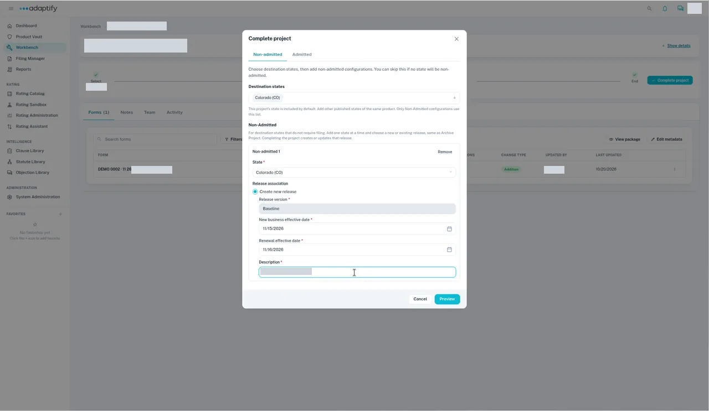

# Complete as Non-admitted

Use **Non-admitted** for states that don't need a filing, for example when you add a new state to a product. Completing the project creates a release in the Product Vault directly.

## Steps

1. Go to **Workbench** and open the project. Every child project should be at **End**.
2. Select **Complete project**.
3. Choose the **Non-admitted** tab. Under **Destination states**, the project's state is already listed. You can add other published states of the same product.
4. Select **Add non-admitted** and choose the **State**. Under **Release association**, choose **Create new release**. For a new state or a new product, the **Release version** is **Baseline**.
5. Pick the **New business effective date** and **Renewal effective date** from the calendar and enter a **Description**. Then select **Preview** and check it: it lists each state, its release and each asset's change.

    

6. Select **Complete project**.
7. Open **Product Vault**, then the product and state. The release you created is listed under **Release**. A new **Baseline** release is marked **Current release**, with no **Review & publish** step.

!!! tip
    **Preview** works only with dates picked from the calendar, not typed. Don't press Escape inside a date field: it closes the whole dialog.

## What happens next

Check the new release in the Product Vault. See [Understand releases](../../product-vault/releases.md). To add the state's rules, see [Update rules](../update-rules.md).
