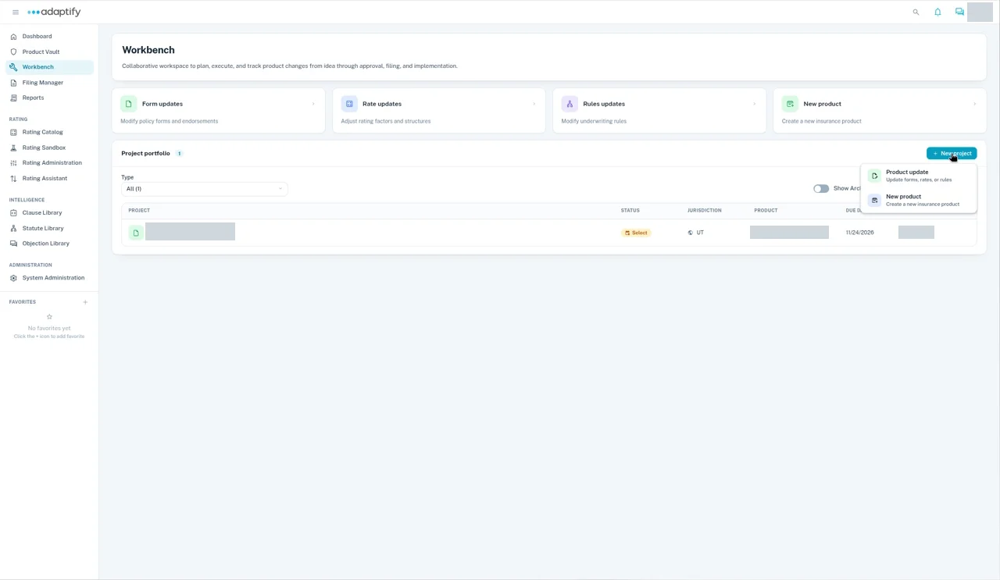

# Create a project

In **Workbench**, choose **+ New project** at the top right of the **Project portfolio**. A menu opens with two choices, **Product update** and **New product**. **New product** also covers adding a state to an existing product:

| Choice | Use it to | Guide |
|---|---|---|
| **Product update** | Update forms, rates or rules of a product that's already published in the Vault. | [Start a product update](product-update.md) |
| **New product** | Create a new insurance product. | [Build a new product in Workbench](../new-product/index.md) |
| **New product**, then **New jurisdiction for existing product** | Add a state to a product that's already in the Vault, starting from another state's forms. | [Start a project to add a state](new-jurisdiction.md) |

Every project opens at its first phase, **Select**. From there, see [Move work through phases](../phases.md).
