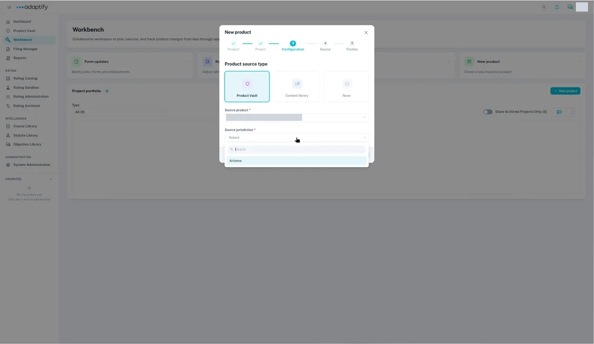
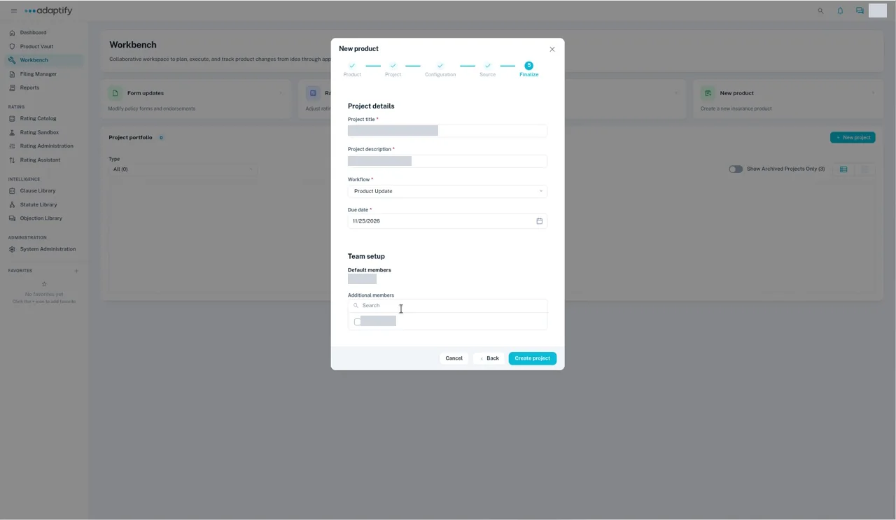

# Start a project to add a state

Ready to sell a product in a new state? Start from the forms of a state you've already published, and add the new state's own forms as you go. When you complete the project as Non-admitted, the new state gets its own release in the Product Vault.

A **New jurisdiction for existing product** project does this. You find it under **New product** in the **New project** menu.

Use this when you're expanding into a new state where you don't have the product yet. If you already sell the product in the state but the state was never added in Adaptify, [add it with Edit product](../../product-vault/add-a-state/edit-product.md) instead.

## Before you start

The product is published in the state you'll copy from. See [Review and publish](../../product-vault/review-and-publish.md).

## Steps

1. In **Workbench**, select **+ New project**, then **New product**.
2. **Product:** under **Product type**, keep **New jurisdiction for existing product**. It's selected at first.
3. **Project:** choose **Forms**.
4. **Configuration:** keep **Product Vault** as the **Product source type**. Choose the **Source product** and the **Source jurisdiction** whose forms you want to copy. **Source jurisdiction** lists only states that have a release.

    

5. **Source:** choose the **Target jurisdiction** (the new state) and the **Type of insurance**, for example 19.0 Personal Auto. Add a **Subtype of insurance** if one applies. The **Existing product** is already filled in.
6. **Finalize:** enter the **Project title** and **Project description**, choose the **Workflow**, and pick a **Due date** from the calendar. Add anyone else under **Additional members**.

    

7. Select **Create project**. The project opens in the **Select** phase. The **Forms** tab lists the source state's forms with the change type **Include**.

**Target jurisdiction** lists only states the product doesn't have yet.

!!! note "Known limitation: forms only"
    This project copies the source state's forms only. Rates, manuals and supporting materials aren't copied. To add the new state's rules after it's published, see [Update rules](../update-rules.md).

## What happens next

Review the copied forms, add the new state's own forms and publish the new state. See [Copy a state's forms to a new state](../../product-vault/add-a-state/from-existing-state.md).
