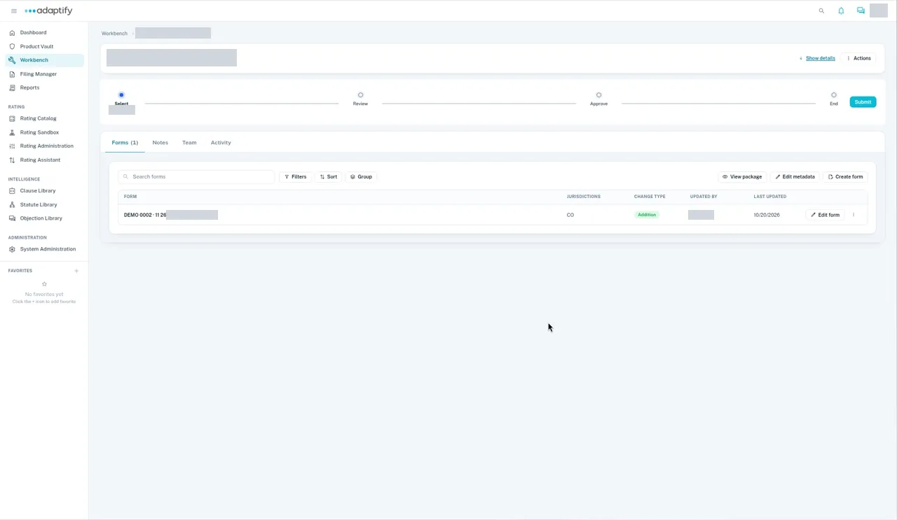

# Add the product's documents

Every new product starts as an idea and takes shape in the Project Workbench. Your team builds its forms, rates and rules in Workbench projects, and they all come together in the product's release.

After you [start a new product project](start.md), add the product's forms to it. There are three ways to add a form:

- **Create it from its details:** a new form starts with its form number, edition and name.
- **Add an existing document:** upload the form's Word or PDF file with the same details.
- **Bulk import:** bring in many forms at once.

Each form you add is listed in the project as an addition.

## Rates and rules

A project has one type, so rates and rules each need their own project. Start it the same way as your forms project, but choose rates or rules as the project type, then add each rate with its name and edition, or each rule with its number, edition and name.

Rates and rules projects merge into the product's release. They don't create a separate product.

Next: [Finish and publish the new product](finish.md).
