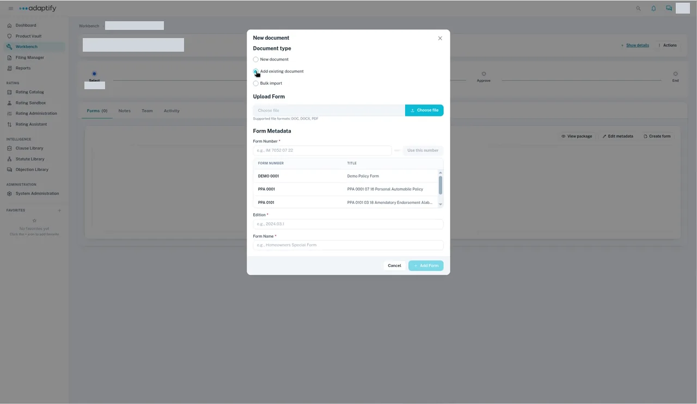
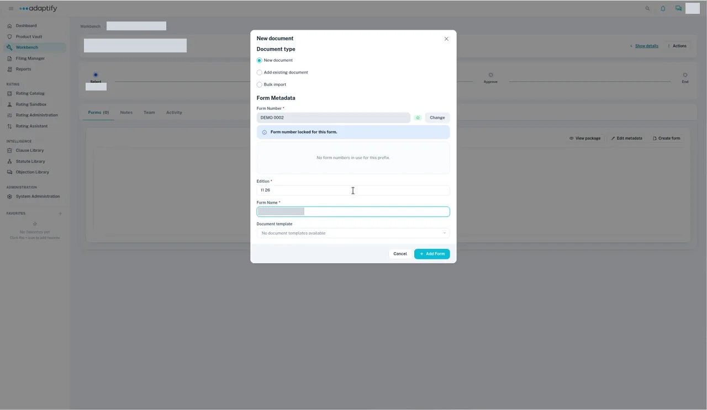

# Add the product's documents

After you [start a new product project](start.md), add the product's forms to it. A **Forms** project has a **Forms** tab only, with no **Rates** or **Rules** tabs.

## Add a form with its file

1. Open the project in **Workbench**. On the **Forms** tab, select **Create form**. The **New document** dialog opens.
2. Under **Document type**, choose **Add existing document**.
3. Under **Upload Form**, select **Choose file** and pick the form's file (DOC, DOCX or PDF).
4. Enter a **Form Number**, then select **Use this number** to lock it. You see "Form number locked for this form." To pick another number, select **Change**.
5. Enter the **Edition** and the **Form Name**.
6. Select **Add Form**. You see "Successfully added new form", and the form is listed with the change type **Addition**.

Repeat for each form. To change a form later, select **Edit form** on its row.

## Other document types

- **New document** takes the form's details only, with no file upload (a known limitation). Use **Add existing document** when you have the file.
- **Bulk import** adds many forms at once from an inventory workbook (.xlsx) and a folder of documents. `TODO verify` the steps; they're covered in a later page.

## Rates and rules

A project has one type, so rates and rules each need their own project. `TODO verify` how to start a **Rates** or **Rules** project for a new product.

Next: [Finish and publish the new product](finish.md).
