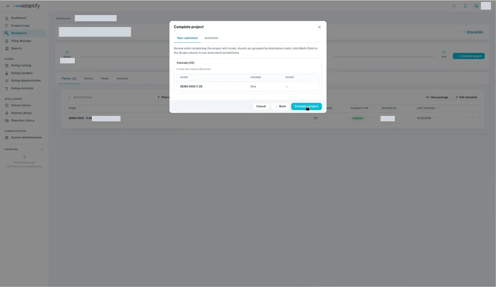
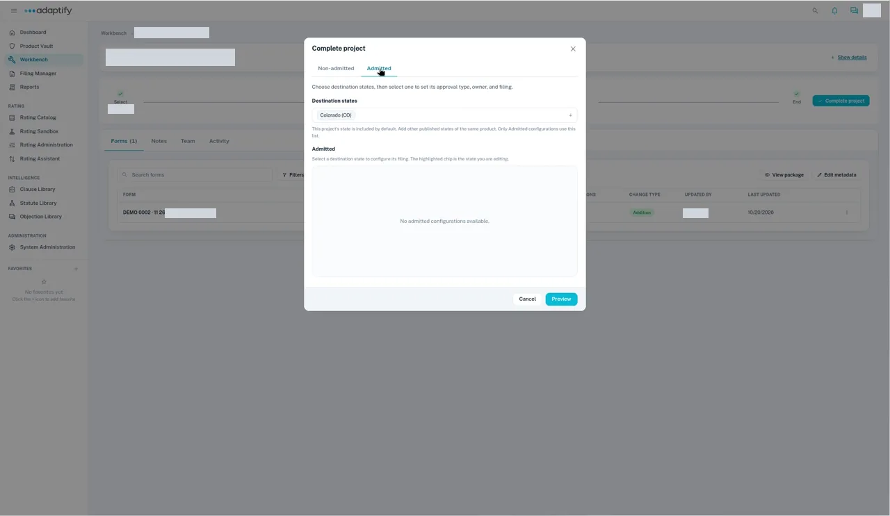

# Finish and publish the new product

When the product's forms are in, move the project through its phases, then complete it. Completing it as **Non-admitted** puts the product in the Product Vault with its first release.

## Move the project to End

1. On the project, select **Submit**. It appears once the project has a form.
2. The dialog shows the **Current phase** and **Next phase**. Under **Select Assignee**, choose the person. Add a **Due date** if you want one, enter your notes under **Add notes**, then select **Submit**. You see "Successfully submitted!".
3. Repeat through **Select** → **Review** → **Approve** → **End**. From **Approve** to **End**, the dialog asks only for notes. A rates project goes straight from **Select** to **End**.

From **Review** on, the person in that phase can also select **Reject**. See [Move work through phases](../phases.md).

## Complete the project

1. At **End**, select **Complete project**.
2. On the **Non-admitted** tab, the project's state is already under **Destination states**. Select **Add non-admitted**.
3. Choose the **State**. **Release association** is **Create new release**, and **Release version** is **Baseline**.
4. Pick the **New business effective date** and **Renewal effective date** from the calendar, and enter a **Description**.
5. Select **Preview**. It lists the state, "Create new release (Baseline)", and each form with the change **New**.
6. Select **Complete project**. `TODO verify` what you see right after you confirm.

In the **Product Vault**, the product's release is **Baseline**, marked **Current release**, with your forms on the **Forms** tab. You don't need **Review & publish**.

!!! tip
    Pick dates from the calendar. Typed dates may not be saved.

## If the Admitted tab is empty

If the **Admitted** tab shows "No admitted configurations available.", complete the project as **Non-admitted**. `TODO verify` whether admitted configurations can be set up for new products. For filings, see [Complete as Admitted](../complete-project/admitted.md).

