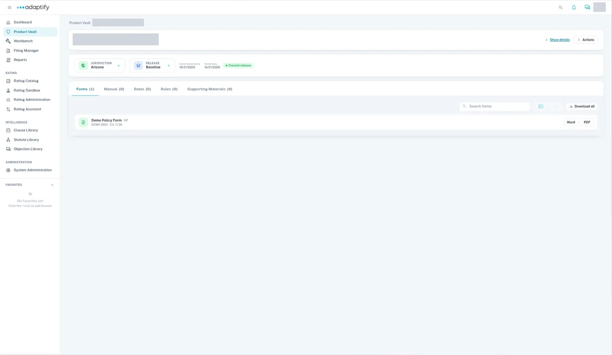

# Finish and publish the new product

When the product's documents are in, move the project through its phases, then complete it. Completing it as **Non-admitted** puts the product in the Product Vault with its first release.

## Move the project to End

1. On the project, select **Submit**.
2. Choose the assignee in **Select Assignee**, add a **Due date** if you want one, and enter your notes in **Add notes**. Submit again. You see "Successfully submitted!".
3. Repeat through **Select** → **Review** → **Approve** → **End**. From **Approve** to **End**, you only add notes.

From **Review** on, the next person can also select **Reject**. See [Move work through phases](../phases.md).

## Complete the project

1. At **End**, select **Complete project**.
2. On the **Non-admitted** tab, select **Add non-admitted**.
3. Choose the **State**. **Release association** is **Create new release**, and **Release version** is **Baseline**.
4. Pick the **New business effective date** and **Renewal effective date** from the calendar, and enter a **Description**.
5. Check the **Preview**. It lists the state, "Create new release (Baseline)", and each form with the change **New**.
6. Confirm. `TODO verify` the confirm button label.

You land on the product in the **Product Vault**. Its release is **Baseline**, marked **Current release**, with your forms on the **Forms** tab. You don't need **Review & publish**.

!!! tip
    Pick dates from the calendar. Typed dates may not be saved.

## Filing it instead

The **Admitted** tab creates a filing project instead, with an **Approval Type** (**Prior approval**, **File and use** or **Use and file**) and an **Owner**. See [Complete as Admitted](../complete-project/admitted.md). `TODO verify` this path for a new product.
