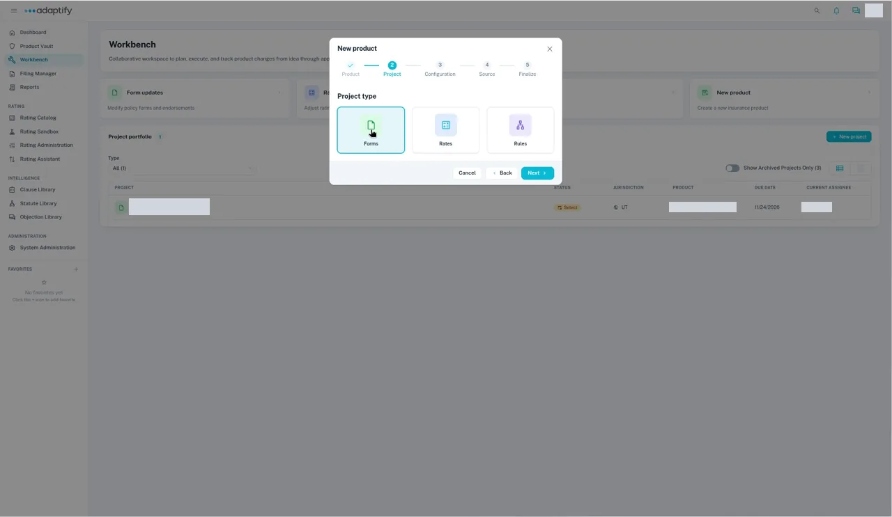
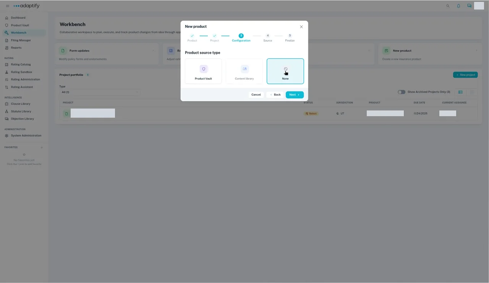
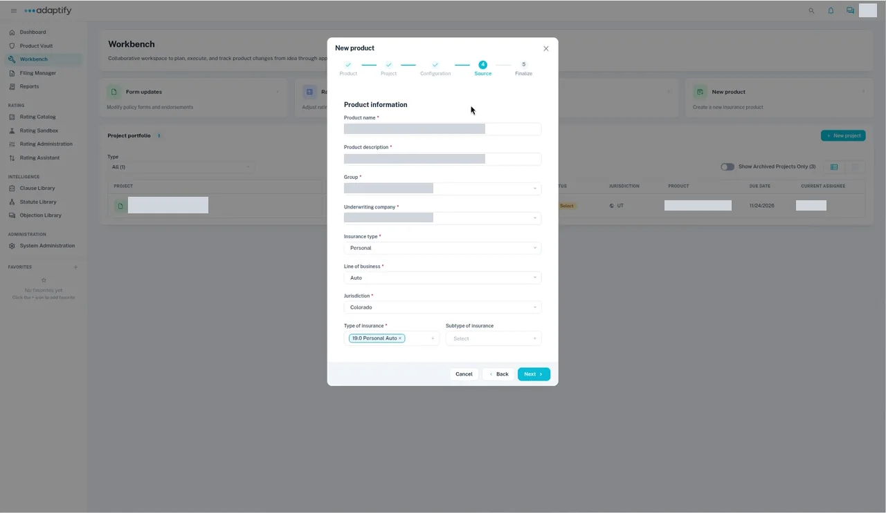
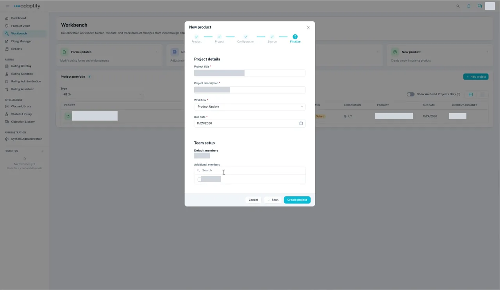
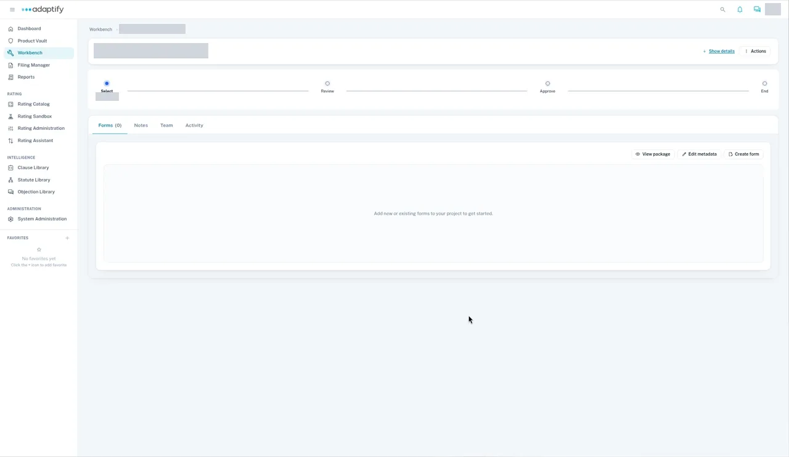

# Start a new product project

Start here when your team is building a brand-new insurance product. The **New product** wizard has five steps: **Product**, **Project**, **Configuration**, **Source** and **Finalize**. Select **Next** to move on, or **Back** to change an earlier step.

## Steps

1. Go to **Workbench**, select **+ New project**, then choose **New product** ("Create a new insurance product").
2. **Product:** under **Product type**, select the **New product** card. (The other card, **New jurisdiction for existing product**, adds a state to a product you already have. See [Start a project to add a state](../create-project/new-jurisdiction.md).)

    

3. **Project:** under **Project type**, choose **Forms**. A project has one type, so rates and rules each need their own project.

    

4. **Configuration:** under **Product source type**, choose **None**.

    

5. **Source:** under **Product information**, enter the **Product name** and **Product description**, then choose the **Group**, **Underwriting company**, **Insurance type**, **Line of business**, **Jurisdiction** and **Type of insurance** (for example 19.0 Personal Auto). **Subtype of insurance** is optional.

    

6. **Finalize:** under **Project details**, enter the **Project title** and **Project description**, choose the **Workflow**, and pick a **Due date** from the calendar. Under **Team setup**, you're listed in **Default members**. Add anyone else under **Additional members**.

    

7. Select **Create project**. The project opens at **Select**, the first of its phases (**Select** → **Review** → **Approve** → **End**), with the **Forms**, **Notes**, **Team** and **Activity** tabs. The **Forms** tab reads "Add new or existing forms to your project to get started."

!!! tip
    Pick the due date from the calendar. Typed dates may not be saved.

If **Underwriting company** shows "No Options" for your group, ask your organization admin to set up the group's underwriting companies. `TODO verify` where admins set them up.

Next: [Add the product's documents](add-documents.md).
