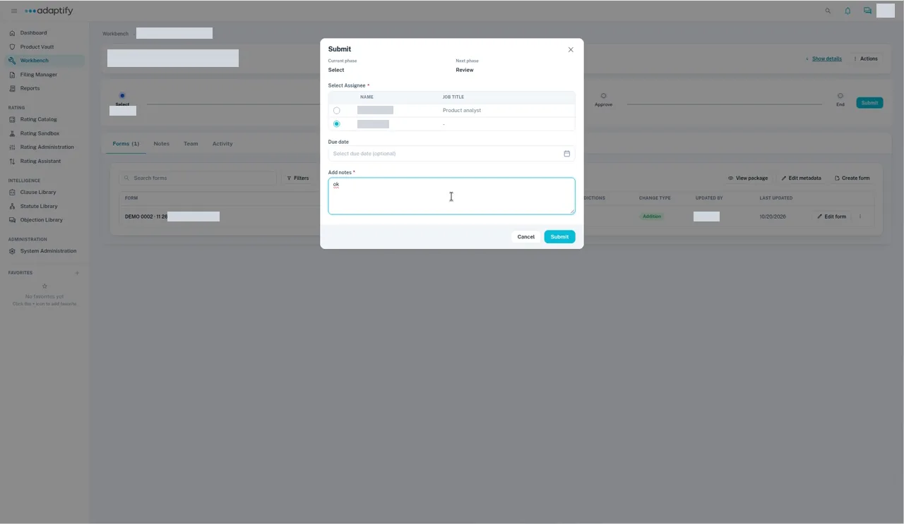
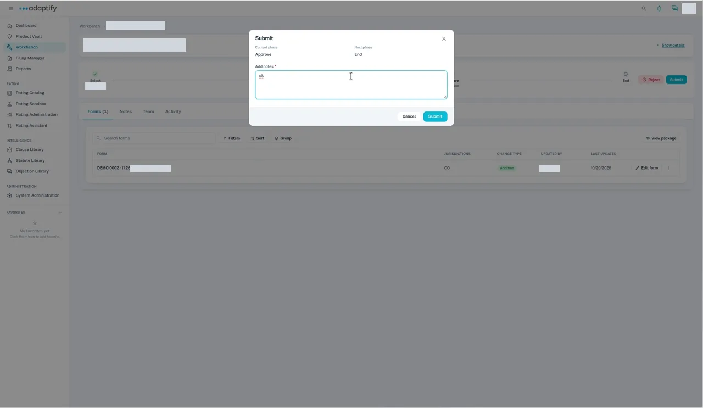

# Move work through phases

Each Workbench project follows a workflow made of phases. When your part is done, you submit the project to the next phase and hand it to the next person.

## Steps

1. Go to **Workbench** and open the project. If your update covers several types, open the child project you're working on, for example the forms project (see [Update forms](update-forms.md)).
2. Check the current phase on the project page.
3. Select **Submit**. The dialog shows the **Current phase** and **Next phase**.
4. Under **Select Assignee**, choose the person for the next phase.
5. If you want a due date, pick it from the calendar. It's optional.
6. Under **Add notes**, add notes for the next person, for example "Ready for review."
7. Select **Submit**. You see "Successfully submitted!", and the project moves to the next phase.

Moving from **Approve** to **End** asks only for notes.

From **Review** on, the person in that phase can also select **Reject**.

!!! tip
    Pick dates from the calendar instead of typing them. Wait for the dialog to finish before you move on.

## Phases by project type

| Project type | Workflow | Phases |
|---|---|---|
| Forms | **Product Update** | **Select** → **Review** → **Approve** → **End** |
| Rates | **Rate Update** | **Select** → **End** |
| Rules | **Rule Update** | **Select** → **Review** → **Approve** → **End** |

Your organization admin manages these workflows under **Workflow management** on the Dashboard. If your organization has changed its workflows, your phases may differ.

## Delete a project you started by mistake

While the project is in **Select**, open **Actions** and choose **Delete**. From **Review** on, **Actions** no longer appears.

## What happens next

When every child project reaches **End**, the project shows **Complete project** next to the phase stepper. Use it to finish the project. See [Complete a project](complete-project/index.md).
